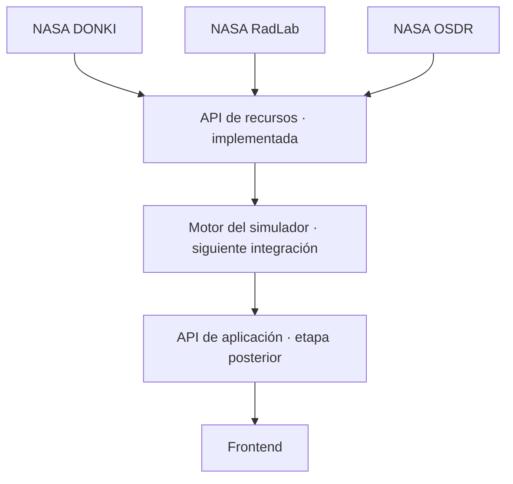

# SpaceApp2026 · Órbita

Entrenador de decisiones y recursos para una misión espacial. La primera pieza implementada es la **API interna de recursos científicos**, que suministrará datos a la lógica del simulador.

| Componente | Estado |
| --- | --- |
| API de recursos NASA | Implementada en `services/resource-api` |
| Cliente de ejemplo para la lógica | Implementado en `examples/logic_client.py` |
| Motor de simulación | Pendiente de incorporar/conectar en este repositorio |
| API para frontend | Etapa posterior |

Consulta la [instalación en Windows y las rutas](services/resource-api/README.md), el [contrato de integración](docs/resource-api-contract.md) y las [fuentes y criterios científicos](docs/scientific-sources.md).
